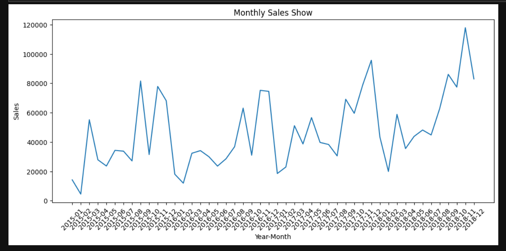
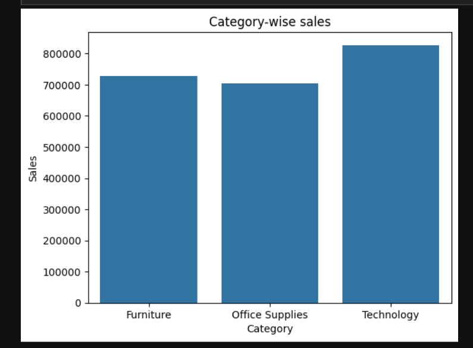

# Superstore-Sales-Analysis

## 📊 Project Overview
Analyzed Global Superstore sales data (9,994 orders) to find out which products, categories, and regions are driving profit and where the company is losing money.

Tools used: Python, Pandas, Matplotlib, Seaborn

## 🔍 Key Findings
- **Technology** is the top category in sales, but **Furniture** has the lowest profit margin despite high sales.
- **West & East regions** generate maximum sales, while **Central region** has low profit due to high discounts.
- **Phones, Chairs & Storage** are top-selling products, but **Tables & Bookcases** are in loss due to heavy discounting.
- Discount above 30% is directly eating profit, especially in Furniture.

## 📈 What I Did
1. Cleaned data - handled missing values, fixed date formats
2. Exploratory Data Analysis - Sales vs Profit by Category, Region, Sub-Category
3. Visualized trends with bar charts, heatmaps & line plots
4. Gave business recommendations to increase profit
  ## 📈 Visualizations

### Monthly Sales Trend

### Sales by Category

## 💡 Business Recommendations
- Reduce discount on Furniture (Tables, Bookcases)
- Focus marketing on high-profit products like Phones, Accessories, Copiers
- Improve sales strategy in Central region
-
## 📂 Files in this Repo
- `Sales.ipynb` - Full analysis with code & charts
- `sales.csv` - Dataset

## 👤 Author
**Raj** | Aspiring Data Analyst
